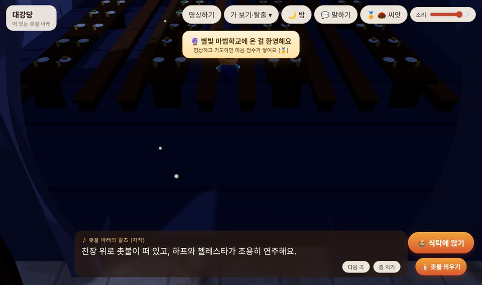
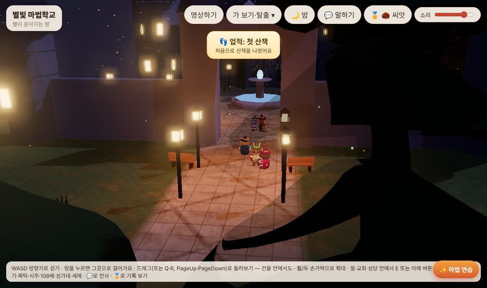
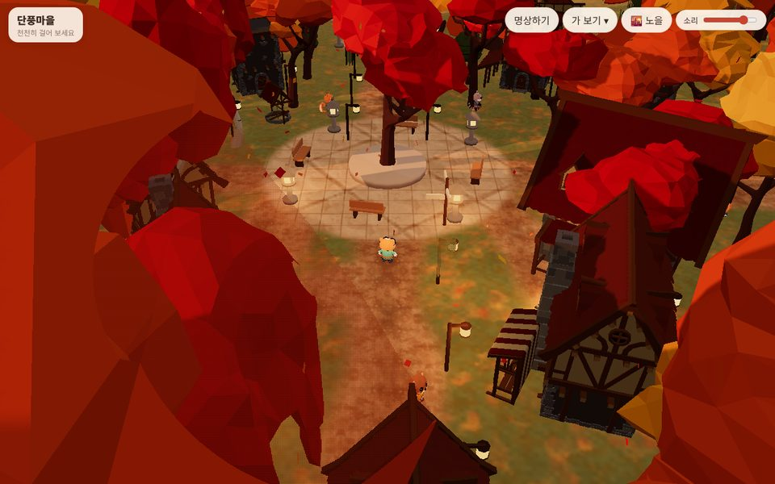

# 마음 산책 — 마음 쉬어가는 곳

동물 친구와 천천히 걸으며 쉬어 가는 힐링 웹사이트예요. 시작 화면에서 **맵**을 골라요.

| 맵 | 분위기 | 할 수 있는 일 |
|---|---|---|
| 🍁 **단풍마을** | 단풍이 물든 작은 마을 (노을) | 절: 절·108배·목탁·시주·향 / 교회: 기도·성가대 / 성당: 기도·촛불·세례와 오늘의 운세 |
| 🔮 **별빛 마법학교** | 별이 쏟아지는 밤의 마법학교 (큰 달, 빛 먼지) | 대강당: 떠 있는 촛불 아래 식탁에 앉기·촛불 띄우기 / 도서관: 책 읽기(지어낸 마법책 한 구절)·책 고르기 / 안뜰: 마법진에서 마법 연습 / 천문대: 별 보기(지어낸 별자리) |

맵은 주소 뒤에 `?map=village`, `?map=school`을 붙여도 바로 열려요. 마지막으로 간 맵을 기억해요.

**바로 가기:** https://mhyoo-games.github.io/meditation_web/

### 별빛 마법학교

- **성:** 뾰족 지붕의 대강당(긴 식탁 4줄, 교수 단상, 장미창, 기숙사 깃발 넷, 떠 있는 촛불 90개 — 안에 들어가면 지붕이 사라져 밤하늘 아래 촛불이 떠 있어요), 도서관(벽 책장·사다리·초록 등 책상·떠다니는 책·샹들리에·지구본), 둥근 탑 7개(가장 높은 탑 21m), 남문과 성벽, 분수 안뜰, 마법진, 천문대 테라스, 호수와 떠 있는 등불, 소나무 숲. 모두 `tools/school.py`로 만든 모델이에요(특정 작품의 건물·문장·이름은 쓰지 않았어요).
- **주민:** 그림책풍 견습 마법사 동물 11종(animal-asset `characters_pc`). 책을 읽을 때는 손에 책을, 마법 연습 때는 지팡이를 들어요.
- **소리 (모두 브라우저에서 합성, 녹음 없음, 선율은 모두 새로 지음):**
  - 밖: 「별빛 왈츠」(라단조 3/4, 첼레스타 선율 + 하프 화음·글리산도 + 현악 패드), 「안개 낀 탑」 / 바람, 부엉이, 귀뚜라미
  - 대강당: 「촛불 아래의 왈츠」(바장조) + 장작 타는 소리
  - 도서관: 「책장 사이의 꿈」(리디아 음계로 드문드문 울리는 첼레스타 + 패드) + 시계 소리, 책장 넘기는 소리
  - 천문대: 「별의 노래」(합창 '아·오·우' + 별처럼 반짝이는 첼레스타)
- 마음 기록에 책 읽기·마법 연습·별 보기와 업적 6개(마법학교 입학, 책벌레, 열 권의 책, 첫 마법, 꼬마 마법사, 별지기)가 더해졌어요.

### 단풍마을

### 지도와 안정성
- **🗺️ 지도:** 오른쪽 위(휴대폰은 오른쪽 아래)의 동그란 작은 지도에 내 위치·바라보는 쪽·주민·장소 이름이 보여요. 누르거나 M 키를 누르면 큰 지도가 펼쳐지고, 장소 이름이나 지도를 누르면 그곳으로 걸어가요.
- **꺼짐 방지:** 한 장면에서 오류가 나도 화면이 멈추지 않고 계속 그려요. 그래픽 메모리가 모자라 브라우저가 화면을 거둬 가면 안내를 띄우고 기록을 저장한 뒤 다시 불러와요(고른 동물은 그대로). 처음으로 돌아갈 때마다 동물의 뼈 텍스처가 쌓이던 것도 정리했어요.
- **가볍게 만들기 (꺼짐 대책 4, 마법학교):** 마법학교가 한 장면에 삼각형 약 155만 개(그림자 포함)로 마을(약 87만)보다 훨씬 무거웠어요. 가장 큰 몫은 소나무 230그루(46만 개, 그림자까지 두 번)였어요 → 소나무는 그림자를 그리지 않고, 먼 소나무는 화질에 따라 덜 심어요(보통 1/3, 가볍게 6할 줄임). 학교 동물(`characters_pc`)도 `tools/slim_heads.py assets/characters_pc 5000 9000 2500`으로 머리·눈 무늬·귀·꼬리를 줄였어요(11MB → 7.5MB, 얼굴은 나란히 그려 비교해 거의 같음). 학교 땅 격자도 절반.
- **가볍게 만들기 (꺼짐 대책 3):** 점프 맵(하늘 오름 숲)을 없앴어요. 동물은 화질에 맞는 주민 수만큼만 불러와요(가볍게: 11마리 중 6마리 + 고른 동물). 배포에는 사이트에 쓰는 파일만 올리고, README 화면 사진은 작은 JPG로 바꿨어요.
- **가볍게 만들기 (꺼짐 대책 2):** 동물 머리가 하나에 삼각형 5만 개(꼬리 4만 개)라 동물 11마리를 그림자까지 그리면 장면이 무거웠어요. `tools/slim_heads.py`로 머리는 7천 개, 꼬리·귀는 4천 개로 줄였어요(가까이서 봐도 거의 같아요). 캐릭터 파일이 50MB → 20MB로 줄었어요.
- **⚙️ 화질:** 가볍게 / 보통 / 선명하게. 휴대폰과 메모리가 적은 기기는 '가볍게'(해상도 1배, 빛 번짐 끔, 소품 그림자 끔, 풀·먼 나무 줄임, 땅 격자 절반, 주민 6마리)로 시작하고, PC는 '보통'으로 시작해요. 화면이 한 번 꺼지면 다음에는 한 단계 낮춰서 열어요. 위의 ⚙️ 버튼으로 바꿀 수 있어요.
