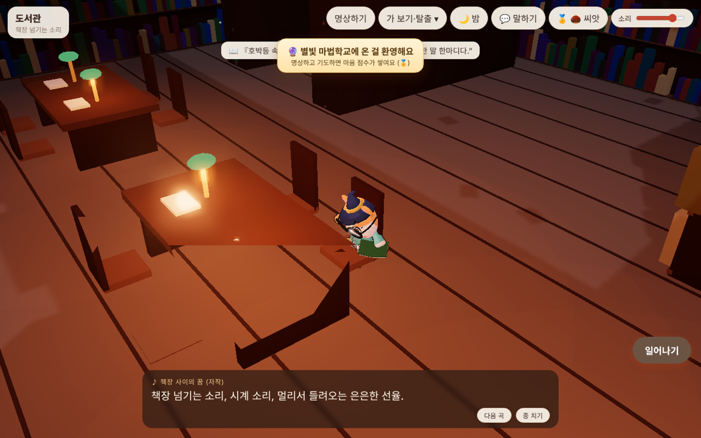
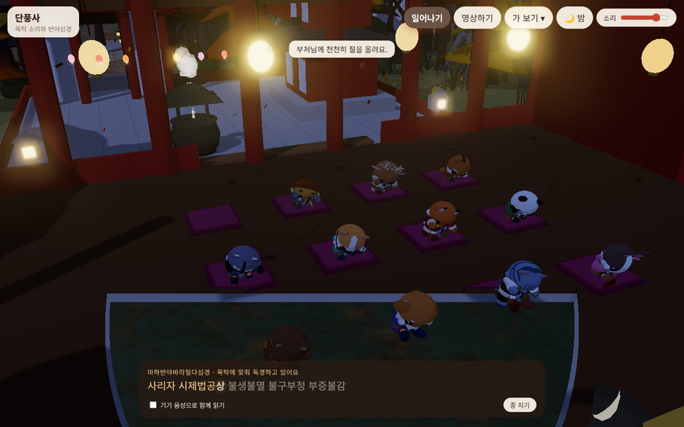
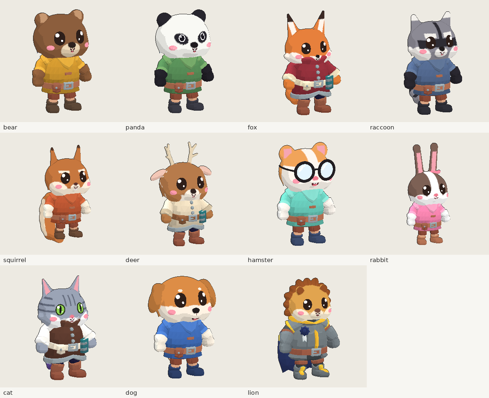

# 마음 산책 — 마음 쉬어가는 곳

동물 친구와 천천히 걸으며 쉬어 가는 힐링 웹사이트예요. 시작 화면에서 **맵**을 골라요.

| 맵 | 분위기 | 할 수 있는 일 |
|---|---|---|
| 🍁 **단풍마을** | 단풍이 물든 작은 마을 (노을) | 절: 절·108배·목탁·시주·향 / 교회: 기도·성가대 / 성당: 기도·촛불·세례와 오늘의 운세 |
| 🔮 **별빛 마법학교** | 별이 쏟아지는 밤의 마법학교 (큰 달, 빛 먼지) | 대강당: 떠 있는 촛불 아래 식탁에 앉기·촛불 띄우기 / 도서관: 책 읽기(지어낸 마법책 한 구절)·책 고르기 / 안뜰: 마법진에서 마법 연습 / 천문대: 별 보기(지어낸 별자리) |

맵은 주소 뒤에 `?map=village` 또는 `?map=school`을 붙여도 바로 열려요. 마지막으로 간 맵을 기억해요.

**바로 가기:** https://mhyoo-games.github.io/meditation_web/


### 별빛 마법학교





- **성:** 뾰족 지붕의 대강당(긴 식탁 4줄, 교수 단상, 장미창, 기숙사 깃발 넷, 떠 있는 촛불 90개 — 안에 들어가면 지붕이 사라져 밤하늘 아래 촛불이 떠 있어요), 도서관(벽 책장·사다리·초록 등 책상·떠다니는 책·샹들리에·지구본), 둥근 탑 7개(가장 높은 탑 21m), 남문과 성벽, 분수 안뜰, 마법진, 천문대 테라스, 호수와 떠 있는 등불, 소나무 숲. 모두 `tools/school.py`로 만든 모델이에요(특정 작품의 건물·문장·이름은 쓰지 않았어요).
- **주민:** 그림책풍 견습 마법사 동물 11종(animal-asset `characters_pc`). 책을 읽을 때는 손에 책을, 마법 연습 때는 지팡이를 들어요.
- **소리 (모두 브라우저에서 합성, 녹음 없음, 선율은 모두 새로 지음):**
  - 밖: 「별빛 왈츠」(라단조 3/4, 첼레스타 선율 + 하프 화음·글리산도 + 현악 패드), 「안개 낀 탑」 / 바람, 부엉이, 귀뚜라미
  - 대강당: 「촛불 아래의 왈츠」(바장조) + 장작 타는 소리
  - 도서관: 「책장 사이의 꿈」(리디아 음계로 드문드문 울리는 첼레스타 + 패드) + 시계 소리, 책장 넘기는 소리
  - 천문대: 「별의 노래」(합창 '아·오·우' + 별처럼 반짝이는 첼레스타)
- 마음 기록에 책 읽기·마법 연습·별 보기와 업적 6개(마법학교 입학, 책벌레, 열 권의 책, 첫 마법, 꼬마 마법사, 별지기)가 더해졌어요.

### 단풍마을


### 이번에 더한 것
- **절(단풍사):** 🙇 절하기 · 📿 108배(절 횟수를 세어 108번에 마침) · 🪵 목탁 치기(손짓에 맞춰 똑똑) · 🪙 시주하기(게임 안의 시주) · 🌫️ 향 피우기
- **교회:** 🎵 성가대 함께하기 — 누르면 근처 주민들이 성가대 자리로 모여 함께 노래하고, 오르간 선율을 여러 목소리가 같이 불러요. 음표가 떠올라요.
- **성당:** 💧 세례 받기 — 이름(별명)을 넣으면 세례명(이름마다 늘 같음)과 오늘의 운세(날마다 바뀜, 재미로)를 알려 줘요. 이름은 이 기기에만 저장돼요.
- **🏅 마음 기록:** 명상·기도·절·노래한 시간, 절·108배·목탁·시주·촛불 횟수, 들른 날과 연속 방문이 쌓여 마음 점수와 단계(씨앗 → 새싹 → … → 깨달음)가 올라가요. 업적 20개, 단계 보상(칭호, 빛 방울, 반딧불, 꽃잎, 빛 고리). 기록은 브라우저(localStorage)에만 저장돼요.
- **💬 말하기:** 자유 채팅 없이 정해진 말과 이모티콘만 골라서 말풍선으로 건네요. 근처 주민이 이모티콘으로 답해요.
- **휴대폰:** 절하기·기도하기 같은 행동 버튼을 화면 아래 가운데 크게 띄워요.
- **움직임:** 돌계단·나무 계단은 디딤판마다 발이 닿도록 높이를 계단 모양으로, 앉기·절하기는 자리로 순간이동하지 않고 살짝 걸어 들어가 돌아선 뒤 천천히 앉아요(부드러운 전환).

## 즐기는 법

- 처음 화면에서 함께 걸을 동물을 고르고 **산책 시작**을 눌러요. 소리가 나요.
- **걷기:** WASD·방향키 (Shift를 누르면 조금 빨리), 또는 땅을 누르면 그곳으로 걸어가요
- **점프:** Space 또는 화면의 ⤴ 점프 버튼. 공중에서 한 번 더 누르면 바라보는 쪽으로 빛 꼬리를 남기며 휙 날아가는 2단 점프예요. 점프 100번·2단 점프 50번 업적이 있어요 (마음 점수는 쌓이지 않아요). 공중 자세 동작은 `tools/kk_jump.py`로 만들었어요.
- **둘러보기:** 드래그(또는 Q·R 키, PageUp·PageDown)로 시점 돌리기, 휠·두 손가락으로 확대. 절·교회·성당 **안에서도** 마음대로 돌려 볼 수 있어요. 카메라와 캐릭터 사이를 가리는 벽·나무·지붕은 점무늬로 비쳐 보여요.
- **🌇 노을 / 🌙 밤 / ☀️ 낮:** 오른쪽 위 버튼으로 시간을 바꿔요. 밤에는 길가 종이등·석등·연못 연등·절 안 연등이 켜지고 빛이 번져요.
- **가 보기·탈출:** 절·교회·성당·광장·연못·우리 집으로 알아서 걸어가요
  - **🆘 끼임 탈출:** 어딘가에 끼어 못 움직일 때 가장 가까운 빈자리(안 되면 광장)로 옮겨요. 막힌 곳 안에 들어가 있으면 그냥 걸어서도 빠져나올 수 있고, 방향키를 눌러도 1초 넘게 안 움직이면 알아서 빼 줘요.
  - **🔄 처음으로:** 처음 화면으로 돌아가 동물을 다시 골라요
- **명상하기:** 그 자리에 앉아 호흡 안내(4초 들이쉬고 6초 내쉬기)를 보여 주고, 카메라가 천천히 돌아요
- **장소에서 하는 일:** 절·교회·성당 안에 들어가면 지붕이 사라져 안이 보이고, 버튼(또는 E)으로 그곳에서만 하는 일을 해요
  - 단풍사: **절하기**(방석 12자리, 앉아서 합장하고 천천히 큰절), **향 피우기**(향로에서 연기가 피어올라요)
  - 은행나무 교회: **앉아서 기도하기**(신자석 42자리, 두 손 모아 기도)
  - 별빛 성당: **앉아서 기도하기**(24자리), **촛불 켜기**(봉헌 촛대에 초가 하나씩 켜져요)
- **길찾기:** 가 보기·땅 누르기로 걸을 때 건물뿐 아니라 나무·바위·등불·벤치·우물·수레 같은 장애물도 돌아서 가요 (0.4m 격자 A* 길찾기, 장애물 약 520개). 동물끼리도 겹치지 않게 서로 비켜 가요.
- 장소에 가까워지면 그곳 음악이 서서히 커지고, 마을 음악은 작아져요. 아래 자막에 지금 흐르는 곡이나 독경 구절이 나와요.

## 장소와 소리

| 장소 | 모습 | 소리 |
|---|---|---|
| 단풍 광장 (마을) | 돌바닥 광장과 큰 단풍나무, 흙길과 종이등이 늘어선 단풍길, 석등, 동물 주민 11채의 목조 집, 우물·장터 노점·정자·모닥불·수레, 연잎과 떠 있는 연등이 있는 연못, 둘레의 빽빽한 단풍 숲과 먼 산 | 오르골·칼림바 즉흥 연주, 바람, 새소리, 낙엽 바스락 |
| 단풍사 (절) | 산기슭 절: 주홍 인왕문과 돌계단, 넓은 돌마당, 주홍 삼층탑, 향로, 큰 본당(안에 금빛 불상·연꽃 대좌·광배·불단, 방석 12자리)과 기둥 격자 위로 단풍 골짜기에 걸친 나무 무대 | 목탁 + 반야심경 독경, 범종(맥놀이), 풍경 |
| 은행나무 교회 | 하얀 목조 교회(안: 신자석 14줄, 제단, 십자가, 강대상, 파이프오르간, 트리), 종탑과 활짝 열린 빨간 문, 리스 | 오르간 찬송가·캐럴: 기쁘다 구주 오셨네, 나 같은 죄인 살리신, 징글벨, 고요한 밤 거룩한 밤 |
| 별빛 성당 | 고딕 대성당: 윗면이 평평한 쌍탑, 장미창, 왕의 회랑, 세 개의 아치 문(가운데 열림), 날개 버팀벽, 지붕 위 첨탑. 안: 기둥 두 줄, 신자석, 제단과 십자고상, 성모상, 봉헌 촛대 | 성가대 + 오르간 + 종: 키리에(그레고리오 성가풍), 오소서 오소서 임마누엘, 고요한 밤 |



### 소리를 만든 방법

녹음 파일은 하나도 없어요. 모든 소리를 브라우저의 Web Audio로 그 자리에서 합성해요 (`js/audio.js`).

- **목탁:** 짧게 떨어지는 사인파 두 개와 나무 부딪는 잡음
- **반야심경:** 한글 반야심경을 한 글자씩 목탁 한 번에 맞춰 읽어요. 각 글자의 모음(ㅏ·ㅓ·ㅗ·ㅜ·ㅡ·ㅣ…)에 맞춰 남자 목소리 포먼트를 바꾸고, 받침 ㄴ·ㅁ·ㅇ은 콧소리로, ㅅ·ㅈ·ㅊ·ㅎ은 바람 소리를 넣었어요. 낮은 음 하나로 읊다가 구절 끝에서 음이 내려가요. 자막에 지금 읽는 글자가 표시돼요.
  - **기기 음성으로 함께 읽기**를 켜면 기기의 한국어 음성(TTS)이 구절마다 같이 읽어요. 기기에 따라 음성이 없을 수 있어요.
- **범종:** 64Hz 근처에서 살짝 어긋난 두 음이 부딪혀 "웅~웅~" 맥놀이가 나요. 30~50초마다 울리고, 종 치기 버튼으로 직접 칠 수도 있어요.
- **오르간·성가대:** 오르간은 배음을 섞은 파형, 성가대는 "아·오·에" 모음 포먼트를 합성한 합창이에요. 반주 화음은 선율에 맞춰 I·IV·V·vi 중에서 자동으로 골라요.

### 노래 저작권

교회와 성당 노래는 모두 작곡된 지 100년이 훨씬 넘은 **퍼블릭 도메인 선율**이에요. 가사는 쓰지 않았어요.
- Joy to the World (Lowell Mason 편곡 1839), Amazing Grace (선율 1835), Jingle Bells (1857), Silent Night (Franz Gruber 1818), Veni Emmanuel (15세기 성가)
- 키리에는 그레고리오 성가 느낌으로 새로 지은 선율이에요.
- 반야심경 한글 독송본은 오래된 경전 번역문이라 저작권 문제가 없어요.

## 동물 주민

모두 1단계(일상복) 모습이에요. 플레이어가 고르지 않은 동물들은 마을 주민이 되어 돌아다녀요. 절에서 절하고 향을 피우고, 교회·성당 의자에 앉아 기도하고 촛불을 켜고, 광장에서 환호하고, 연못가를 거닐고, 집에 들러요. 시작 화면 초상은 Kenney Isometric Miniature Bases(CC0)의 풀 받침 위에 그렸어요.



| 동물 | 단풍마을 | 별빛 마법학교 |
|---|---|---|
| 햄스터 | 밤톨 | 별똥 |
| 토끼 | 호두 | 방울 |
| 고양이 | 모카 | 은하 |
| 강아지 | 갈잎 | 바람 |
| 곰 | 고구마 | 이끼 |
| 판다 | 송편 | 수정 |
| 여우 | 홍시 | 반딧불 |
| 너구리 | 솔방울 | 톱니 |
| 다람쥐 | 단풍이 | 책갈피 |
| 사슴 | 억새 | 이슬 |
| 사자 | 노을 | 오로라 |

이름은 맵마다 달라요 (`js/maps.js`의 `who`).

| 동물 | 옷 | 동물 | 옷 |
|---|---|---|---|
| 햄스터 | 프로그래머 (민트 상의, 동그란 안경) | 판다 | 초록 셔츠 |
| 토끼 | 제빵사 (분홍) | 여우 | 와인색 코트 |
| 고양이 | 바리스타 (갈색 조끼) | 너구리 | 푸른 셔츠, 줄무늬 꼬리 |
| 강아지 | 우체부 (파란 셔츠) | 다람쥐 | 단풍색 셔츠, 큰 꼬리 |
| 곰 | 겨자색 니트 | 사슴 | 크림 니트, 뿔과 흰 점 |
| 사자 | 마을 경비대장 (갑옷, 남색 망토) | | |

- 햄스터·토끼·고양이·강아지·사자는 [animal-asset](https://github.com/mhyoo-games/animal-asset)의 1단계 모델이고, 곰·판다·여우·너구리·다람쥐·사슴은 이 사이트를 위해 새로 만들었어요.
- 몸체·뼈대·걷기/앉기 동작은 KayKit Adventurers(CC0)를 쓰고, 동물 머리·귀·꼬리는 직접 만들었어요. 귀와 꼬리는 따로 까딱여요.
- 절하기(`Bow`)·앉아 기도(`Pray_Sit`)·서서 합장(`Pray_Stand`)은 KayKit 동작에 합장한 팔과 허리 숙이기를 더해 새로 만들었어요 (`tools/kk_pray.py`).
  - 절하기는 7초 동안: 합장 → 허리·가슴·머리가 차례로 조금씩 늦게 숙여지고(부드러운 smootherstep 곡선, 초당 30장) 두 손이 바닥 앞으로 내려감 → 엎드린 채 숨쉬기 → 천천히 일어나 다시 합장. 처음과 끝 자세가 같아 반복해도 끊기지 않아요.

## 폴더

```
index.html, css/, js/
  js/main.js     장면, 걷기, 카메라, 주민 행동, 낙엽, 자막, 명상
  js/audio.js    모든 소리 합성 (마을·절·교회·성당)
  js/nav.js      길찾기 (격자 A* + 직선 펴기)
assets/
  village/village.glb        절·교회·성당·광장·연못·등불 (지붕은 따로 숨길 수 있는 노드)
  village/village_layout.js  건물·집 위치, 소리 구역, 실내(지붕 숨김), 행동 자리, 높이맵(241×241), 걸을 수 있는 단, 막힌 곳, 소품 배치 735개, 등불 위치
  props.glb                  나무·덤불·바위·풀·집 등 Quaternius 모델 55종 (+ 단풍 색 변형), 브라우저에서 InstancedMesh로 배치
  tex/                       땅 무늬: Kenney Isometric Miniature Bases 윗면에서 뽑은 흙·돌·풀 무늬 + 바닥 무늬 지도(splat.png: 흙길·돌바닥·낙엽)
  sky.jpg, sky_night.jpg     하늘 (Kenney Skyboxes 아침·밤, CC0). 노을 하늘은 브라우저에서 그라데이션으로 그려요
  portraits/*.png            시작 화면 동물 초상
  characters/*.glb           동물 11종
  animations/kaykit_animations.glb  걷기·달리기·앉기·환호·절하기·기도 등 15개 동작 (모든 동물 공용)
tools/                       모델과 마을을 다시 만드는 파이썬 스크립트 (animal-asset의 도구가 필요해요)
```

정적 파일만 있어서 아무 웹 서버로 열 수 있어요. 예: `python3 -m http.server` 후 http://localhost:8000/
`main` 브랜치에 올리면 GitHub Actions가 GitHub Pages로 배포해요.

## 라이선스

- 몸체·뼈대·동작: KayKit Adventurers Character Pack — Kay Lousberg, CC0 (`KAYKIT-LICENSE.txt`)
- 하늘·초상 받침·땅 무늬: Kenney Skyboxes, Kenney Isometric Miniature Bases — CC0 (`KENNEY-*-LICENSE.txt`)
- 나무·덤불·바위·풀·꽃·연잎·집·우물·노점 등: Quaternius Ultimate Nature Pack, Medieval Village Pack — CC0 (`QUATERNIUS-LICENSE.txt`). 단풍잎과 지붕 색은 바꿨어요.
- 빛 번짐: three.js UnrealBloomPass (MIT)
- 마법학교 주민의 그림책풍 모습은 웹툰 Pepper&Carrot(David Revoy, CC BY 4.0)의 분위기를 참고했어요. 원작 그림·캐릭터는 쓰지 않았어요.
- 동물 머리, 마을, 소리, 코드: 직접 제작
- three.js (MIT)는 CDN에서 불러와요
